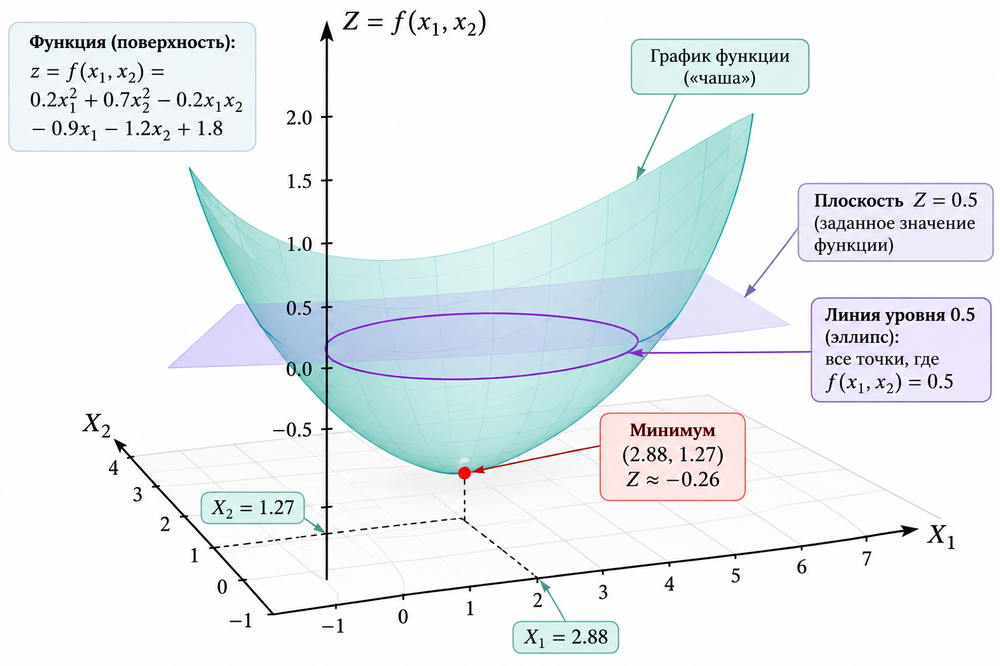
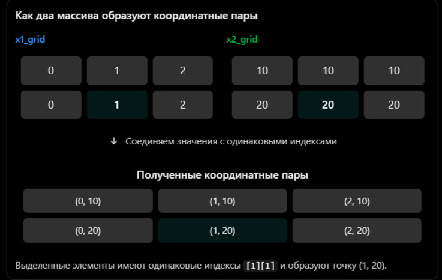

# Билет № 11. Многомерная оптимизация: линии уровня и 3D-поверхность

**Темы:** Python · NumPy · SciPy · Matplotlib · оптимизация · экзамен

> [!NOTE]
> **💡 Идея**  
> У функции два аргумента — `x1` и `x2` (их можно считать обычными X и Y). Результат `f(x1, x2)` — третья координата **Z**, то есть высота поверхности. Мы строим график, рассматриваем линии одинаковой высоты и находим самую низкую точку.

## Шаг 1. Функция из билета

$$
f(x_1,x_2)=0.2x_1^2+0.7x_2^2-0.2x_1x_2-0.9x_1-1.2x_2+1.8
$$

```python
def objective(point):
    x1 = point[0]
    x2 = point[1]
    return (
        0.2 * x1**2 + 0.7 * x2**2
        - 0.2 * x1 * x2 - 0.9 * x1 - 1.2 * x2 + 1.8
    )

print(objective([0, 0]))  # 1.8
print(objective([2, 1]))  # -0.1
```

- `x1` и `x2` — положение точки **по горизонтальным координатам**.
- `objective([x1, x2])` — **высота** поверхности в этой точке.
- Высота — **не** `x2`, а отдельное значение `Z = f(x1, x2)`.

## Шаг 2. Что такое «чаша» и её дно

Представь поверхность, похожую на чашу. Её дно — точка с наименьшим значением **Z**. При этом координаты `x1` и `x2` на стенках чаши могут быть и меньше, и больше координат дна.

Для этой функции:

| Величина | Приблизительно |
|---|---:|
| `x1` в минимуме | `2.88462` |
| `x2` в минимуме | `1.26923` |
| `Z = f_min` | `-0.25962` |

**Важно:** `x2 = 1.26923` — не высота дна! Это его координата на оси Y. Высота дна — `-0.25962` на оси Z.

### Трёхмерная поверхность функции



У функции три координаты:

- **X₁** — положение по первой горизонтальной оси.
- **X₂** — положение по второй горизонтальной оси.
- **Z = f(X₁, X₂)** — высота поверхности.

Минимум находится примерно в точке:

$$
(X_1, X_2, Z) = (2.88,\ 1.27,\ -0.26)
$$

> [!IMPORTANT]
> **Главное:** координата X₂ = 1.27 — это не высота дна! Высота дна — Z = −0.26.  
> Если пересечь чашу горизонтальной плоскостью **Z = 0.5**, получим эллипс — линию уровня 0.5.

## Шаг 3. Линии уровня

**Линия уровня `L`** — множество всех точек `(x1, x2)`, в которых `f(x1, x2) = L`.

- Уровень `1.5`: все координаты, где высота равна `1.5`.
- Уровень `1.0`: высота равна `1.0`.
- Уровень `0.5`: высота равна `0.5`.
- Уровень `0.1`: высота равна `0.1`.

Если мысленно разрезать 3D-чашу горизонтальной плоскостью `Z = 0.5`, линия пересечения поверхности с плоскостью, спроецированная на координатную плоскость, и есть линия уровня `0.5`.

Для данной квадратичной функции линии уровня — **вложенные эллипсы**. Уровень `1.5` снаружи, `0.1` ближе к центру, а в центре — минимум `-0.25962`.

> [!TIP]
> **Пример для понимания:** линии уровня — как горизонтали высот на географической карте. На всей линии одинаковая высота, хотя координаты X и Y различаются.

## Шаг 4. Зачем нужны диапазоны `linspace`

```python
x1_values = np.linspace(-1, 7, 100)
x2_values = np.linspace(-1, 4, 100)
```

`np.linspace(start, stop, num)` создаёт `num` равномерно расположенных значений от `start` до `stop` **включительно**.

- `[-1, 7]` — какую часть оси X хотим видеть.
- `[-1, 4]` — какую часть оси Y хотим видеть.
- `100` — сколько значений берём для каждой оси; это детализация сетки, а не положение минимума.

**Откуда границы?** Они **не заданы в билете**, а выбраны, чтобы целиком вместить все четыре эллипса. Внешняя линия уровня `1.5` примерно занимает:

| Ось | От | До |
|---|---:|---:|
| `x1` (X) | `-0.19` | `5.96` |
| `x2` (Y) | `-0.38` | `2.91` |

Отсюда удобные интервалы с запасом: `[-1, 7]` и `[-1, 4]`. Они разные, потому что эллипс сильнее вытянут **по X**, чем по Y.

**Практический способ подобрать границы без заранее найденного минимума:** взять широкие диапазоны (например, `[-5, 10]` по обеим осям), нарисовать линии уровня, расширить границы, если линии обрезаются, либо сузить их при большом количестве пустого пространства.

> [!IMPORTANT]
> **Разные задачи:** `linspace` и `meshgrid` задают область **рисования**. `minimize` сам ищет минимум и не ограничен этой областью (если не передать `bounds`). Нахождение минимума заранее необязательно для построения линий уровня.

## Шаг 5. Что делает `meshgrid`

```python
import numpy as np

x1_values = [0, 1, 2]
x2_values = [10, 20]
x1_grid, x2_grid = np.meshgrid(x1_values, x2_values)

# x1_grid:       x2_grid:
# [[0, 1, 2],    [[10, 10, 10],
#  [0, 1, 2]]     [20, 20, 20]]
```

Элементы с одинаковыми индексами дают одну координатную пару: `x1_grid[1, 1] == 1` и `x2_grid[1, 1] == 20` → точка `(1, 20)`.

Получаем **все комбинации**: `(0,10)`, `(1,10)`, `(2,10)`, `(0,20)`, `(1,20)`, `(2,20)`.

Это **не `zip`**: `zip` соединяет элементы только по одинаковым позициям исходных списков, а `meshgrid` формирует их декартово произведение в виде двух согласованных матриц. Число строк равно длине `x2_values`, число столбцов — длине `x1_values` (стандартный режим `indexing="xy"`).

### Визуализация координатной сетки `meshgrid`

| | X₁ = 0 | X₁ = 1 | X₁ = 2 |
|---|---|---|---|
| X₂ = 10 | (0,10) | (1,10) | (2,10) |
| X₂ = 20 | (0,20) | (1,20) | (2,20) |

Каждая ячейка таблицы — отдельная точка координатной сетки.



Теперь:

```python
function_values = objective([x1_grid, x2_grid])
```

NumPy рассчитает значение функции для каждой из шести точек без явного цикла Python.

> [!TIP]
> **Для чего это?** `meshgrid` создаёт координаты точек; `objective` рассчитывает значения Z; `contour` строит линии одинаковых Z.

## Шаг 6. Почему `objective` принимает массивы без `for`

```python
x1_grid, x2_grid = np.meshgrid(x1_values, x2_values)
function_values = objective([x1_grid, x2_grid])
```

При работе с `numpy.ndarray` операции `**`, `*`, `+`, `-` выполняются **поэлементно**. Поэтому функция вычисляет результат для каждой пары координат и возвращает матрицу значений Z той же формы. Цикл Python внутри `objective` не нужен. Это называется **векторизацией**.

## Шаг 7. Строим 2D-линии уровня

```python
fig, ax = plt.subplots(figsize=(9, 6))
contours = ax.contour(
    x1_grid, x2_grid, function_values,
    levels=[0.1, 0.5, 1.0, 1.5]
)
ax.clabel(contours, inline=True, fmt="%.1f")
```

- `contour(X, Y, Z)` находит на сетке места, где функция имеет заданные уровни, и соединяет их линиями.
- `levels` — значения **высоты Z**, **не** координаты X/Y.
- `clabel` подписывает линии (`0.1`, `0.5` и т. д.).

По вложенным линиям можно **примерно оценить**, где расположен центр — будущий минимум. Затем выбрать стартовую точку, например `[2, 1]`.

## Шаг 8. Ищем минимум

```python
result = minimize(objective, [2, 1], method="BFGS")

print(f"x1 = {result.x[0]:.5f}")
print(f"x2 = {result.x[1]:.5f}")
print(f"f_min = {result.fun:.5f}")
print(f"success = {result.success}")
```

- `[2, 1]` — **стартовое предположение**, а не ответ.
- `result.x` — координаты минимума на плоскости X/Y.
- `result.fun` — значение функции (высота Z) в этой точке.
- `result.success` — сообщил ли алгоритм об успешном завершении.

Ожидается `x1 ≈ 2.88462`, `x2 ≈ 1.26923`, `f_min ≈ -0.25962`.

> [!NOTE]
> **Где ещё используется `minimize`?**  
> `minimize()` применяется не только к обычным математическим функциям, но и к задачам химического равновесия. Например, для реакции:
>
> $$
> H_2 + I_2 \rightleftarrows 2HI
> $$
>
> Подбираем равновесные концентрации веществ так, чтобы сумма квадратов невязок баланса была минимальной.  
> **[Подробнее: оптимизация концентраций и минимизация невязок](chemical-equilibrium.md).**

## Шаг 9. Полная минимальная программа: 2D + 3D

> [!NOTE]
> **Запуск:** установить зависимости: `pip install numpy scipy matplotlib`. Сохранить код ниже как `.py` и запустить. Откроются два графика: линии уровня и трёхмерная поверхность. В интерактивном окне Matplotlib 3D-график обычно можно вращать мышкой (зависит от backend).

### Программа: 
> ```python 
> import numpy as np
> import matplotlib.pyplot as plt
> from scipy.optimize import min...
> ```
> **[Смотреть продолжение](../../src/optimization/levels_t11.py)**

## Итоги

1. `objective([x1, x2])` вычисляет **высоту Z** в конкретной точке X/Y.
2. `linspace` выбирает диапазоны X/Y **для картинки**.
3. `meshgrid` строит все пары координат, а NumPy вычисляет значения `objective` для них сразу.
4. `contour` соединяет места с **одинаковыми Z**: это линии уровня.
5. `plot_surface` показывает ту же функцию как **трёхмерную чашу**.
6. `minimize` независимо подбирает X/Y, при которых Z минимален.

[Следующий материал: химическое равновесие и минимизация невязок](chemical-equilibrium.md)
